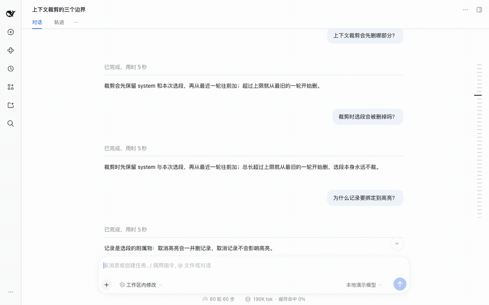

# dsh-clipchat

[](https://www.npmjs.com/package/dsh-clipchat)
[](LICENSE)

在 DSH 的回复里划词就地提问：选中一段文字，浮层出现「引用文本 / 问这段」，点开卡片就能追问，答案不出现在主线消息流里，重点还能像划线一样留在原文上。



```sh
dsh plugin --profile web add dsh-clipchat
```

## 功能

- **划词即问**：只对 assistant 正文生效；用户消息、思考区、工具卡片不出现入口。
- **就近卡片**：选段栏、4 个快捷提问（解释这段 / 翻译 / 找问题 / 举个例子）、问答线程、流式回答、停止生成、输入输出 token。
- **问答线程**：提问与回答分别成块（提问带底色与「问」标记，回答带绿色竖线），每条回答可单独复制；发送后输入框自动清空，等待下一次提问。
- **详细回答**：输入框下方一个 30px 开关，默认关闭。关闭时注入选段 + 整条消息 + 同轮前后 + 前 3 轮；开启后改注整个会话的分层摘要（历史轮次 + 工具名 + 压缩摘要），代价读数与注入明细都在开关上。宿主读不到日志时自动降级回近轮上下文。
- **回答排版**：回答按 Markdown 渲染标题（`#` 与 `===`/`---` 两种写法）、嵌套列表（有序列表从写下的那个序号起编，`- [ ]`/`- [x]` 显示成复选框）、引用（`>>` 嵌套也是一段引用）、分隔线、管道表格（含列对齐，宽表在框内横向滚动，单元格有最小宽度，窄卡片里短标签不会被压成一字一行）与围栏代码块（按语言标注，内容逐字保留、不换行、不解释行内标记，列表项里的代码块留在该项内）；行内支持 `**加粗**`、`*斜体*`/`_斜体_`/`***粗斜***`（可互相嵌套）、`` `行内代码` `` 与双反引号写法、`[文字](https://… "标题")`、`<https://…>` 自动链接、`~~删除线~~` 与 http(s) 图片。复制回答时行内标记会被去掉，表格按制表符分隔，复制出来的文字和卡片里看到的一致。
- **排版边界**：只有 http(s) 图片会显示，`` 这种本地路径没东西可加载，仍原样显示；反斜杠按 CommonMark 只转义 ASCII 标点——`\*` 是一个星号，`C:\Users\me` 保留反斜杠，所以表格单元格里的 `|` 要写成 `\|`；列表嵌套超过 4 层时更深的条目并入最深那一项；不把回答里的 HTML 当标签；任何输入都不会让整条回答渲染失败，解析不了时退回纯文本。
- **连续追问**：同一张卡片里继续问，历史随请求一起带走。
- **可复制**：每条回答下方有「复制」按钮，答案文本也可以直接选中复制；点击卡片内部不会关闭卡片，点卡片外才关闭。
- **模型选择**：默认跟随主会话，也可为某段选段固定一个模型，选择随高亮保存。
- **高亮**：首次提问自动提交，也可手动点「高亮这段」；原文下方显示绿色底线，随会话持久化，点击可回看当时的问答。取消高亮会一并删掉这段选段下的记录（联动），但取消记录不会影响高亮。
- **记录**：记录和划线绑定，一处划线一条记录。每次回答默认自动追加到该划线的记录里，按钮变成「取消记录」可撤销最后一次追加。点「记录 N」后面板占用卡片主体（问答区让位），展开可看这条划线下的全部问答，可删除、定位，或切到「全部会话」搜索历史记录并复制 / 插回主输入框。
- **定位**：每条记录可点击展开完整问答；点「定位到原文」会关闭卡片、跳到该选段所在轮次、把它居中并闪烁绿色底线（点底线可重新打开该选段的问答）。
- **带回主线**：把选段引用 + 不超过 200 字的问答摘要插入主输入框，不自动发送。
- **不污染主线**：不写 session、不建隐藏会话、不声明工具、不调用工具。

## 环境要求

- DSH 0.2.2-rc.3 或同系列版本（依赖其 `conversation.chat.text-interaction` 插槽与 `llm.stream`）。
- Node.js >= 20（仅用于跑测试与本地检查；插件本身没有运行时依赖，也没有构建步骤）。

## 安装

### 从 npm 安装（推荐）

```sh
dsh plugin --profile web add dsh-clipchat
```

装完刷新页面。`client.js` 改动刷新即生效；`index.js` 与 `lib/` 改动需要禁用/启用该插件（或重启 dsh）才会重新注册路由。

### 从本地目录安装（开发期）

1. 确认检出路径里没有空格。若路径含空格（DSH 的安装器会裁掉尾部空格），先建一个干净软链：

   ```sh
   sh scripts/dev-link.sh
   # 输出 /tmp/dsh-clipchat-dev -> <你的检出目录>
   ```

2. 在 DSH 的插件面板里选择本地目录安装，目标填脚本打印的路径。
3. 刷新页面。`client.js` 改动刷新即生效；`index.js` 与 `lib/` 改动需要禁用/启用该插件（或重启 dsh）才会重新注册路由。

## 使用

1. 在 assistant 回复里选中一段文字。
2. 浮层出现「引用文本」和「问这段」；点「问这段」展开卡片，输入框自动聚焦。
3. 直接提问，或点一个快捷提问；回答流式显示，底部显示本次 token。
4. 回答默认自动记录，不需要时点「取消记录」；想把结论带回主线时点「带回主线」。
5. 点空白处、按 Esc、点 × 都能关闭卡片。

## 开发

```sh
npm run check   # 语法检查 + 全量测试（无需安装依赖）
npm test        # 只跑测试
node scripts/preview-markdown.mjs   # 把一份含表格/代码块/嵌套列表的回答用真实样式渲染成 PNG
```

`scripts/preview-markdown.mjs` 用 `client.js` 自己的渲染函数和样式表生成 `artifacts/markdown-preview/preview.html`，再用系统 Chrome 截图成 `preview.png`：排版改动只看单测的元素树不够，最终看的是这张图。

`npm run check` 也会由 `.githooks/pre-commit` 在提交时执行。每个克隆启用一次：

```sh
git config core.hooksPath .githooks
```

## 目录结构

```
index.js          host 半边：webServer 路由、请求守卫、模型解析、存储装配
client.js         browser 半边：包装 quote 插槽、菜单/卡片/线程、SSE、高亮 overlay、记录
lib/context.js    上下文拼装与截断（system + <context> + 历史 + 本次问题）
lib/http.js       JSON 请求体读取、SSE 写入、同源守卫
lib/model.js      模型路由规范化与会话模型解析
lib/digest.js     会话分层摘要：用户消息 + 助手正文 + 工具名 + 压缩摘要（详细模式）
lib/models.js     模型目录汇总与可用性校验
lib/search.js     跨会话记录搜索（纯函数）
lib/store.js      每会话 JSON 存储：原子写、上限、TTL、孤儿清理
locale/           中英文案
test/             node:test 套件，共享夹具在 test/helpers/
scripts/          检查脚本与本地开发链接
```

`client.js` 是手写单文件 bundle，没有构建步骤；浏览器侧不能 import `lib/*.js`，因此少量形状校验（如模型路由）在两半各保留一份。

## 数据与存储

- 位置：`DSH_HOME/clipchat/<sessionId>.json`（回退到 `~/.dsh/clipchat`）。目录 0700、文件 0600、临时文件 + rename 原子写，同一会话的写操作串行化。
- 结构：`{ version: 1, sessionId, updatedAt, highlights: [], records: [] }`。
- 上限：每会话 200 条高亮、500 条记录（每条记录最多 50 轮问答），超出丢最旧；单文件超过 1 MB 时先丢最旧记录，高亮不丢。
- 生命周期：7 天无访问自动清理；归档会话保留；永久删除会话后由孤儿清理删除。无法解析的文件保持原样。
- 跨会话搜索只读：不会因为查询刷新 `updatedAt`，也不会给休眠会话续期。

## HTTP 接口

所有路由先过宿主自己的 `requestRejection` 守卫。

| 方法 | 路径 | 说明 |
|---|---|---|
| GET | `/dsh-clipchat/status` | 开发自检：守卫类型与当前模型 |
| GET | `/dsh-clipchat/models?sessionId=` | 模型目录与会话当前路由 |
| POST | `/dsh-clipchat/ask` | SSE 回答，帧为 `meta` / `delta` / `usage` / `done` / `error` |
| GET | `/dsh-clipchat/session?sessionId=` | 该会话的高亮与记录 |
| GET | `/dsh-clipchat/context?sessionId=` | 详细模式的会话摘要（`{ available, digest, stats }`，读不到时 `available: false`） |
| GET | `/dsh-clipchat/search?q=&limit=` | 跨会话记录搜索（`limit` 默认 20、上限 50） |
| POST | `/dsh-clipchat/highlight` | 高亮增删（`op: add/remove`） |
| POST | `/dsh-clipchat/record` | 记录增删（`op: add/remove`） |

## 上下文拼装

一次提问只带这些内容，顺序固定以利 KV cache：

```
system → <context> → 历史问答 → 本次问题
```

`<context>` 内的块按固定顺序排列：

| 块 | 内容 | 上限 |
|---|---|---|
| `<turn-user>` | 选段所在这一轮的用户消息（提问意图） | 2000 字 |
| `<before>` | 选段所在 step 之前最多 2 个已完成 step 的文本 | 每侧 2000 字 |
| `<message>` | 选段所在 assistant step 的可见文本 | 8000 字（超长时保留选段前后各 2000 字） |
| `<after>` | 选段所在 step 之后最多 2 个已完成 step 的文本 | 每侧 2000 字 |
| `<selection>` | 选段原文 | 2000 字，超出直接拒绝 |
| `<recent>` | 选中轮之前最近 3 个已完成 turn 的 user + assistant | 每轮 1500 字 |

历史问答最多 12 条消息、总输入约 15000 字。超预算时裁剪顺序：最旧历史 → 最旧 recent 轮次 → 前后相邻 step（2000/400/0 字）→ 消息摘录（1000/500/250/0 字）。选段永不裁剪。

## 测试

```sh
npm run check      # 语法检查 + 全量测试 + 覆盖率门槛（提交前钩子也跑这个）
npm run coverage   # 只跑覆盖率报告
```

`npm run check` 要求**每个交付源文件的行覆盖率 100%**，不达标直接失败。唯一豁免写在 `scripts/check.mjs` 的 `ALLOWED_UNCOVERED` 里（`lib/store.js` 两处文件系统异常分支），豁免行一旦被覆盖或列表过期也会失败。

客户端测试跑在真实 DOM（jsdom）+ 真实 React 上：`test/helpers/dom.mjs` 装环境，`test/helpers/mount.mjs` 真正挂载组件。这样「组件渲染时抛错」这类问题会被测到——只检查返回的元素树是看不到的。`load-client.mjs` 用 `vm` 以固定文件名加载 `client.js`，既让每次加载有独立模块状态，又不会把覆盖率拆成多份。

覆盖：路由注册与销毁、守卫、模型解析、上下文拼装与截断、SSE 帧与中断、存储 schema/上限/TTL/孤儿清理/并发写、锚点重锚、搜索与截断、卡片挂载与交互（提问、流式、复制、记录增删、模型菜单、详情条、跨会话搜索）、高亮 overlay 绘制与点击定位。

## 如何跑 E2E

`npm run e2e` 用本机真实的 DSH Web + 系统 Chrome 跑 P0-4：聊天历史滚动到第 36-60 轮后，从记录面板点「定位」，第 10 轮必须被挂载、下划线居中、卡片关闭。同一次运行还会检查回答的渲染：mock 模型返回一份带表格、代码块和嵌套列表的 Markdown，卡片里必须出现真实的 `<table>`（含列对齐）、`<pre><code>`（含语言标注）和嵌套 `<li>`，不能残留 `|---` 或 ``` 原文，表格里那个 `C:\Users\me` 的反斜杠也不能被吞掉，并给表格和代码块各截一张图（两张图都登记在 `result.json` 的 `artifacts` 里）。

前置条件：

- Node.js >= 20.12（E2E 夹具用到 `readdir` 的 `recursive`/`parentPath`；插件本身仍只要求 >= 20）。
- 本机已安装 DSH `0.2.2-rc.3` 同系列，且为 hoisted 布局（`~/.dsh/runtime/node_modules/@deepseek-ai/{dsh-base,dsh-web-app,dsh-headless}` 可读）。
- 已安装 Chrome 或 Chromium（不会自动下载）。
- 首次需要 `npm install` 安装 `puppeteer-core`（仅开发依赖，需网络）。

```sh
npm run e2e                 # 完整跑一遍
npm run e2e -- --headed     # 看得到浏览器窗口
npm run e2e -- --keep       # 保留临时 DSH_HOME 供排查
npm run e2e -- --case p0-04 # 指定用例（目前只有 p0-04）
node e2e/run.mjs --prepare-only   # 只准备临时 home/profile/mock/60 轮夹具，不启动 Web
node e2e/run.mjs --browser-smoke  # prepare 后启动 Chrome、截 about:blank，不跑用例
```

`--prepare-only` 与 `--browser-smoke` 也会写最小 `result.json`，并和其它运行一样清理临时目录（用 `--keep`/`E2E_KEEP_TMP=1` 可保留）。

环境变量：

| 变量 | 作用 |
|---|---|
| `DSH_BIN` | 覆盖 DSH 启动器路径（默认 `~/.dsh/runtime/node_modules/@deepseek-ai/dsh/lib/bin.js`） |
| `E2E_CHROME_PATH` | 覆盖 Chrome/Chromium 可执行文件 |
| `E2E_KEEP_TMP=1` | 保留 `$TMPDIR/dsh-clipchat-e2e/<run-id>/` |
| `E2E_KEEP_LOGS=1` | 成功时也保留 `browser.log` 与 `fixture.log`（默认成功只保留 `result.json`、`web.log`、`mock-llm.log`） |
| `E2E_HEADED=1` | 同 `--headed` |

每次运行使用新的 `runId`、临时 `DSH_HOME`、空闲端口和 mock 模型，产物在 `artifacts/e2e/<run-id>/`：

| 文件 | 内容 | 何时保留 |
|---|---|---|
| `result.json` | 用例、断言明细与耗时、环境版本、产物路径 | 每次 |
| `env.json` | Node / DSH / Chrome / puppeteer-core 版本 | 每次 |
| `web.log` | DSH Web 的标准输出与错误（`token=***` 已脱敏） | 启动 Web 的运行 |
| `mock-llm.log` | 本地 mock 模型的请求摘要 | 每次 |
| `pids.json` | Web 子进程 pid；mock 是进程内服务，标为 `in-process` | 启动 Web 的运行 |
| `fixture.log` | headless 生成、60 轮改写、投影缓存清理记录 | 失败时，或 `E2E_KEEP_LOGS=1` |
| `browser.log` | 页面 console、pageerror、requestfailed | 失败时，或 `E2E_KEEP_LOGS=1` |
| `failure-p0-04.png` | 失败时的全页截图 | 失败时 |
| `failure-p0-04.html` | 失败瞬间的 DOM | 失败时 |
| `browser-smoke.png` | `--browser-smoke` 的 about:blank 截图 | 仅该模式 |
| `p0-04-markdown-table.png` | 卡片里渲染出的表格 | 每次（用例走到那一步） |
| `p0-04-markdown-code.png` | 卡片里渲染出的代码块与嵌套列表 | 每次（用例走到那一步） |

`--prepare-only` 默认保留 `result.json`、`env.json`、`mock-llm.log`（不启动 Web，所以没有 `web.log`；`fixture.log` 仅失败或 `E2E_KEEP_LOGS=1` 时保留）；`--browser-smoke` 另加 `browser-smoke.png`，同样不启动 Web。

失败排查顺序：先看 `result.json` 里哪条断言失败，再对照 `failure-p0-04.png`/`failure-p0-04.html`；启动问题看 `web.log`，模型请求看 `mock-llm.log`。退出码：`0` 全通过，`1` 断言失败，`2` 环境或前置失败。

已知限制：只支持 macOS/Linux + Chromium/Chrome；只支持 hoisted 的 DSH 安装；不接 CI；E2E 夹具的事件形状绑定当前 DSH v4，升级后会在 header/事件校验处 fail fast；定位依赖宿主 rail 的虚拟化结构，插件会先把 rail 滚到目标轮再点「加载并跳转」，DSH 改版若移除该结构，`result.json` 会记录 pitch 与已渲染按钮，可用宿主「加载更早」手工复现。

## 已知限制

- 高亮 overlay 依赖聊天列的 `[data-chat-flow]` 结构，上游改版可能需要跟着调整。
- 多 span 跨块选区只在单块单 span 时做前缀回退，多 span 依赖精确偏移。
- 从高亮打开卡片需要把选区落到该高亮上（宿主 surface 只能由选区唤起），不抢焦点但仍会改变选区。
- 卡片打开期间若聊天区被虚拟化替换掉选区节点，宿主可能关闭浮窗。
- 与隐藏原生引用的插件（如 dsh-sidenote）同时安装时，「问这段」会随引用 surface 一起隐藏。